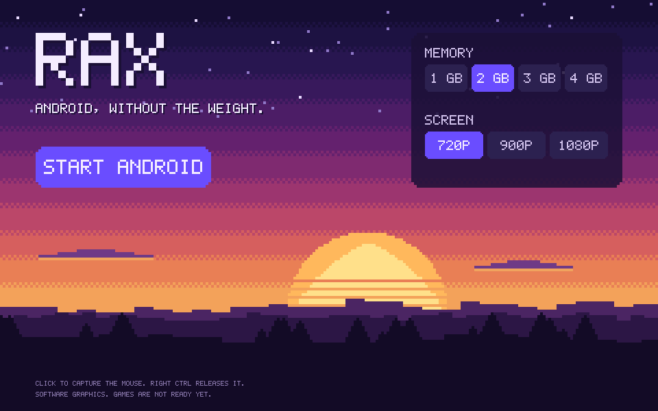

# RAX

[](https://github.com/MrSpideyNihal/rax/actions/workflows/ci.yml)
[](LICENSE)

**A research project to build the lightest practical Android gaming runtime for Windows, in Rust.**

> **Status: Android 9 runs in RAX's own window with mouse and keyboard, on RAX's own VM. It has internet, runs on four virtual CPUs, and draws on the host GPU through API forwarding. Minecraft Bedrock loads worlds and is playable in early testing, with a peak of 61 FPS seen on an RTX 3050. ARM-only games such as Free Fire MAX do not run.** Formal game benchmarks and thermal figures do not exist yet.



## What exists

Run `rax.exe` with no arguments to open the launcher. Everything stays in one folder: delete it and RAX is gone, with nothing left in the registry or AppData. Android keeps your apps in `data.img` in that folder, and dragging an `.apk` onto the window installs it. The app is about 0.7 MB, and the launcher uses about 17 MB of RAM.

F12 switches to game controls, where keys and the mouse become fingers on a virtual multi-touch screen. Android has internet through RAX's own small router, with no driver, no administrator rights, and no setup.

**Google Play is not part of RAX, and it has no licence to ship it.** The Android image `scripts/fetch-android.ps1` currently downloads turned out to contain Google's apps, which conflicts with [ADR-0005](docs/ADR/0005-google-play-policy.md). Until that image is replaced, no RAX download may include it.

| Command | What it does |
|---|---|
| `rax doctor` | Checks WHP, RAM, CPU, and GPUs, and explains blockers |
| `rax bench whp` | Runs a tiny guest under the Windows Hypervisor Platform and measures VM-exit and mapping costs |
| `rax vm run` | Boots Linux or Android on RAX's own Rust VMM, with a serial console, virtual disk, framebuffer, and screenshots |

Results on the target laptop (Ryzen 7 7445HS, Windows 11 Home, VBS on):

- A guest exit costs a **median of 3.0 µs**, with a worst case of 340 µs.
- A tiny Linux 6.18 guest reaches user space in **774 ms on average**, over 10 boots.

Android 9 boots in 33 s on RAX with the GPU, using 2.2 GB of host RAM and 2.3% of one core at idle. That is an old Android on one vCPU, so it is not comparable with a full modern Android. The baseline to beat is Android Studio's emulator running Android 14 with Google Play: **38 s** to boot, **3.6 GB** of host RAM, and **56% of one core** at idle. [Raw data, method and limits](docs/BENCHMARKS.md).

## What the research found

Read the [feasibility report](docs/FEASIBILITY.md). The short version:

- **The runtime looks buildable.** WHP works, and exit cost is not the bottleneck. Game speed through GPU forwarding is the hard part still ahead.
- **Google Play is the real obstacle.** It needs a licence from Google, and engineering cannot replace that. RAX will not bundle, spoof or bypass it ([ADR-0005](docs/ADR/0005-google-play-policy.md)).
- **Minecraft does not need ARM translation.** Its x86_64 build runs on RAX. **BGMI is listed as ARM-only, so it is blocked** until a legal translation path exists.
- **Free Fire and BGMI are goals, not promises.** RAX has no macros and will not hide from anti-cheat ([ADR-0007](docs/ADR/0007-game-goals-and-input.md)).
- **There is no GPU passthrough.** Android's OpenGL ES commands are forwarded to the host through virglrenderer, and we call it API forwarding.

## Quick start

Requires Windows on x86-64 (only Windows 11 has been tested), [Rust](https://rustup.rs), and the "Windows Hypervisor Platform" feature for the benchmark.

```powershell
git clone https://github.com/MrSpideyNihal/rax
cd rax
cargo run --release -p rax-cli -- doctor
cargo run --release -p rax-cli -- bench whp
```

To run Android, fetch the verified image into `guest/`, then open the launcher:

```powershell
./scripts/fetch-android.ps1
cargo run --release -p rax-cli
```

`./scripts/make-portable.ps1` builds the single folder.

To boot Linux instead, download the verified test guest first. It is too large to keep in Git:

```powershell
./scripts/fetch-guest.ps1
cargo run --release -p rax-cli -- vm run --shell --kernel guest/vmlinuz-virt --initrd guest/initramfs-virt
```

## Documentation

| Document | Contents |
|---|---|
| [Feasibility report](docs/FEASIBILITY.md) | Phase 0 findings, risks, targets, next prototype |
| [Architecture](docs/ARCHITECTURE.md) | Target design |
| [Roadmap](docs/ROADMAP.md) | Phases, gates and fallbacks |
| [Benchmarks](docs/BENCHMARKS.md) | Measured data and how to reproduce it |
| [Compatibility](docs/COMPATIBILITY.md) | What has been tested |
| [Decisions](docs/ADR/README.md) | Architecture decision records |

## Project rules

- No benchmark without raw data and a reproduction command.
- No "supported" without a test.
- No fake GPU acceleration, and no silent software rendering.
- No DRM, licence or integrity bypasses. See [ADR-0005](docs/ADR/0005-google-play-policy.md).

Contributions are welcome. See [CONTRIBUTING.md](CONTRIBUTING.md).

## Licence and trademarks

RAX is licensed under [Apache-2.0](LICENSE).

RAX is an independent project, not affiliated with or endorsed by Google, Microsoft, Mojang, or NVIDIA. Android, Google Play, Minecraft, Windows, and other marks belong to their owners and are used only to describe compatibility goals.
