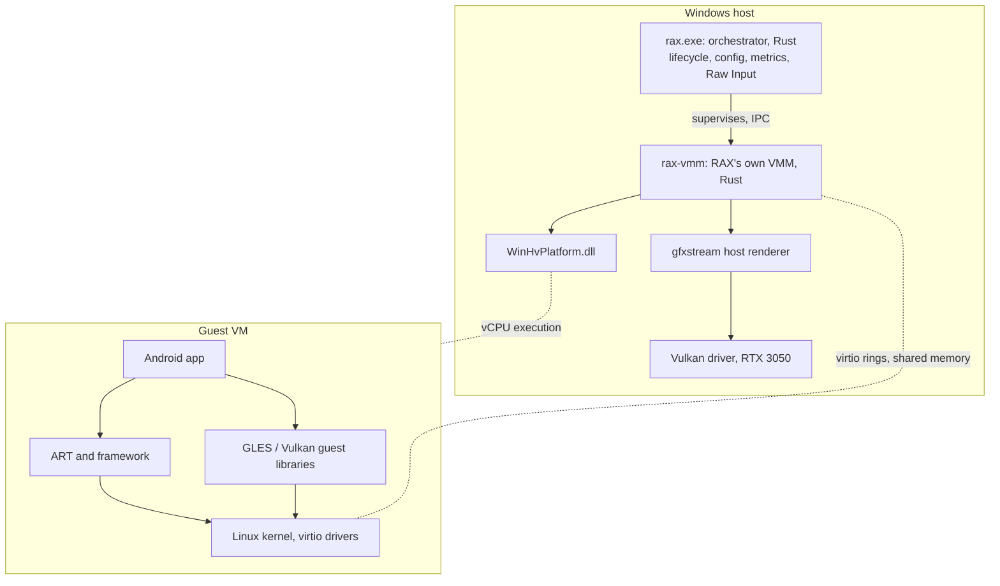

# Architecture

This describes the target design. **Only the parts marked "exists" are built.** Rationale and evidence are in [FEASIBILITY.md](FEASIBILITY.md) and the [ADRs](ADR/).

## Overview



## Principles

1. **Measure before designing further.** Each layer lands with a benchmark.
2. **The repository is enough.** RAX's own VMM needs no outside emulator ([ADR-0006](ADR/0006-own-rust-vmm.md)). The guest OS is still downloaded, with verified hashes.
3. **Reuse before writing.** RAX owns a small monitor, orchestration, input, tuning and measurement. It does not own Android, Linux or a GPU translator.
4. **No hidden software rendering.** If hardware acceleration is not active, RAX says so and refuses to report gaming benchmarks.
5. **Nothing runs when idle.** No background service. Quitting RAX stops the VM.

## Components

| Component | State | Responsibility |
|---|---|---|
| `crates/rax-host` | **exists** | OS integration and all current `unsafe`: WHP, Vulkan probing, host facts, readiness rules, statistics |
| `crates/rax-vmm` | **exists** | Linux boot protocol, initramfs writer, serial, PIC, PIT, RTC, PCI and virtio-blk devices, one vCPU. Forbids `unsafe` |
| `crates/rax-input` | **exists, not connected** | Key-mapping profiles, keyboard and mouse to touch events. Forbids `unsafe` |
| `crates/rax-ui` | **exists** | The launcher: procedural pixel art, a hand-written 5 by 7 font, no toolkit. Forbids `unsafe` |
| `crates/rax-cli` | **exists** | `rax doctor`, `rax bench whp`, `rax vm run`, `rax input check`. Forbids `unsafe` |
| Multiple vCPUs, more virtio devices | planned, Phase 1b | Required before Android is usable |
| Input bridge | planned, Phase 3 | Raw Input to virtio-input |
| Launcher UI | planned, after the GPU pipeline | Small native window |
| Guest image recipe | test guest **exists**, Android planned | `scripts/fetch-guest.ps1` fetches a pinned Alpine Linux guest. AOSP comes in Phase 1b |

Crates are added when real code needs them. The layout proposed in the original brief (`rax-vm`, `rax-memory`, `rax-graphics` and so on) is the expected direction, not a set of empty placeholders.

## Key flows

### Graphics

Not built yet. Guest GLES or Vulkan calls are serialized by gfxstream guest libraries into shared-memory ring buffers and decoded by the host renderer. This is **API forwarding, not GPU passthrough**. The guest never touches the GPU directly.

The ring design matters because it limits VM exits. Exit cost is low (about 3 µs, measured), so the larger concerns are decode cost, synchronization, and the final copy path to the display on hybrid laptops.

### Input

Two kinds of game need different paths. Games with keyboard support may get a real mouse and keyboard, and touch-only games such as Free Fire use the key-mapping engine in `rax-input`, which turns physical input into virtual fingers.

Planned design, to be validated:

```
Raw Input (WM_INPUT) --> rax.exe --> virtio-input --> guest evdev
```

The hypothesis is that Android apps should see a **real mouse and keyboard**, not synthesized touch, because that removes a translation layer. Android supports pointer capture, and Minecraft on ChromeOS suggests keyboard and mouse handling exists in the game. This is unverified for Bedrock on Android. Touch mapping is required for touch-only games. Keyboard and mouse state stay independent, so one device leaving never affects the other ([ADR-0007](ADR/0007-game-goals-and-input.md)).

### Memory

Guest RAM is mapped from host-committed regions through `WHvMapGpaRange`. Reclaim is planned through virtio-balloon free page reporting, handing freed pages back to Windows. WHP behaviour under that churn has **no public data we could find** and is a measured item for Phase 5. Current numbers cover untouched mappings only.

### Lifecycle

A single process with no installed service. The vCPU runs on the main thread, one thread drives time and console input, and the VM ends with the process. Suspend and resume are investigated later.

### Display

The guest draws into a linear framebuffer described through `screen_info`, so the kernel's VESA driver needs no device behind it. Android renders in software. A native Win32 window shows it through GDI, copied while the vCPU is stopped, and `--screenshot` saves it as a BMP. This exists to boot and to see the guest. It is not the gaming graphics path, which remains unsolved.

### Mouse and keyboard

An emulated 8042 with PS/2 keyboard and mouse reaches the guest through port I/O. Windows scancodes are already set 1, so there is no key table. Both devices always exist in the guest, so the host's hardware coming and going cannot disturb them. This gives Android a pointer, and multi-finger touch for key mapping is still to come.

### Storage

Disk requests run on the vCPU thread during the notifying `out` exit, so a slow host disk stalls the guest. Everything the guest supplies is untrusted: descriptor indexes, chain lengths, addresses, and sizes are all checked, and a malformed ring stops the queue rather than panicking. Moving I/O off the vCPU thread is future work, to be justified by measurement.

### One folder

`rax.exe` writes only beside itself: `rax.cfg`, `data.img` for Android's `/data`, and a temporary `inbox.tmp` during a session. Nothing goes in the registry or AppData, so deleting the folder removes RAX.

On first run the app creates an 8 GB `data.img` and boots Android to its console, where Android's own `mke2fs` formats it. The file only gets its final name after that succeeds, so an interrupted first run simply starts again.

An APK dropped on the window is written to the inbox disk, and a command typed into Android's console copies and installs it. This needs no network or adb.

### Boot

RAX boots Linux directly, with no BIOS. It loads the `bzImage` payload, writes `boot_params` with an E820 memory map, adds an init script to the initramfs as a concatenated cpio archive, and enters the kernel's 32-bit entry point. The kernel switches itself to long mode.

Devices are a 16550A serial port, master 8259A PIC, 8254 PIT, CMOS RTC, and a PCI bus holding one legacy virtio block device. Legacy virtio was chosen because its registers are port I/O, which avoids needing an MMIO instruction decoder. Interrupts are injected through the hypervisor's pending-interruption register, and an interrupt-window exit is requested when the guest cannot accept one yet. Reads of absent hardware map a read-only page of `0xFF`, matching what an unclaimed bus returns, so no instruction decoder is needed so far.

## Hypervisor

WHP is the only supported path. It works with VBS, which is on by default on many Windows 11 machines, and it works on Home editions, confirmed on the target laptop. Google is ending the alternative AEHD driver on 31 December 2026, and HAXM is gone from the emulator. See [ADR-0001](ADR/0001-use-windows-hypervisor-platform.md).

## Security

- System DLLs load from `System32` only, closing DLL search-order hijacking.
- `unsafe` lives in `rax-host`, with a `SAFETY` comment required on every block by lint.
- The guest is untrusted. Graphics decode in the VMM is the largest attack surface, and sandboxing it is a Phase 6 requirement.
- See [SECURITY.md](../SECURITY.md).
