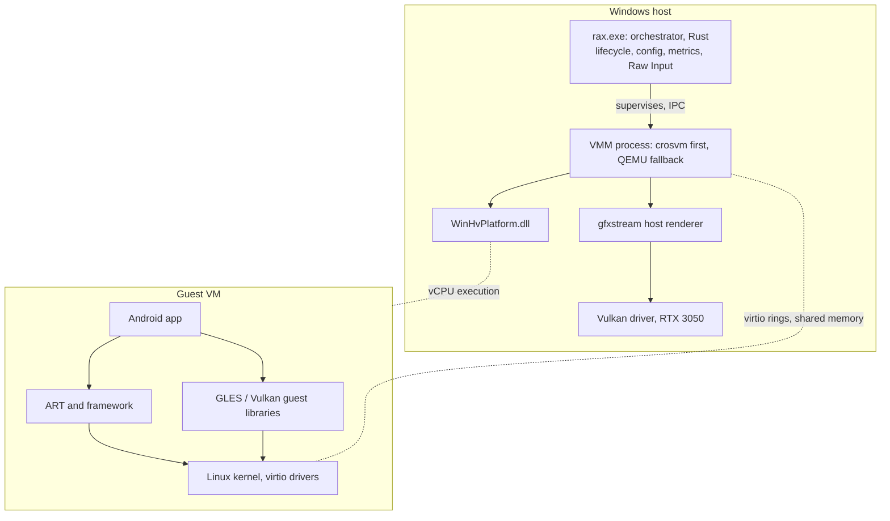

# Architecture

This describes the target design. **Only the parts marked "exists" are built.** Rationale and evidence are in [FEASIBILITY.md](FEASIBILITY.md) and the [ADRs](ADR/).

## Overview



## Principles

1. **Measure before designing further.** Each layer lands with a benchmark.
2. **Process boundaries isolate risk.** The VMM is a child process, so GPL components stay separate and a VMM swap does not touch the orchestrator.
3. **Reuse before writing.** RAX owns orchestration, input, tuning and measurement. It does not own Android, Linux or a GPU translator.
4. **No hidden software rendering.** If hardware acceleration is not active, RAX says so and refuses to report gaming benchmarks.
5. **Nothing runs when idle.** No background service. Quitting RAX stops the VM.

## Components

| Component | State | Responsibility |
|---|---|---|
| `crates/rax-host` | **exists** | OS integration and all current `unsafe`: WHP, Vulkan probing, host facts, readiness rules, statistics |
| `crates/rax-cli` | **exists** | `rax doctor`, `rax bench whp`. Forbids `unsafe` |
| `rax vm` supervisor | planned, Prototype 1 | Start, stop and observe the VMM process |
| Input bridge | planned, Phase 3 | Raw Input to virtio-input |
| Launcher UI | planned, after the GPU pipeline | Small native window |
| Guest image recipe | planned, Phase 1 | Reproducible minimal AOSP x86_64 |

Crates are added when real code needs them. The layout proposed in the original brief (`rax-vm`, `rax-memory`, `rax-graphics` and so on) is the expected direction, not a set of empty placeholders.

## Key flows

### Graphics

Guest GLES or Vulkan calls are serialized by gfxstream guest libraries into shared-memory ring buffers and decoded by the host renderer. This is **API forwarding, not GPU passthrough**. The guest never touches the GPU directly.

The ring design matters because it limits VM exits. Exit cost is low (about 3 µs, measured), so the larger concerns are decode cost, synchronization, and the final copy path to the display on hybrid laptops.

### Input

Planned design, to be validated:

```
Raw Input (WM_INPUT) --> rax.exe --> virtio-input --> guest evdev
```

The hypothesis is that Android apps should see a **real mouse and keyboard**, not synthesized touch, because that removes a translation layer. Android supports pointer capture, and Minecraft on ChromeOS suggests keyboard and mouse handling exists in the game. This is unverified for Bedrock on Android. Touch mapping is the fallback only.

### Memory

Guest RAM is mapped from host-committed regions through `WHvMapGpaRange`. Reclaim is planned through virtio-balloon free page reporting, handing freed pages back to Windows. WHP behaviour under that churn has **no public data we could find** and is a measured item for Phase 5. Current numbers cover untouched mappings only.

### Lifecycle

Single user process tree, no installed service. `rax` starts the VMM on demand and stops it on exit, including when the parent dies, through a Windows Job Object (planned). Suspend and resume are investigated after boot time is known.

## Hypervisor

WHP is the only supported path. It works with VBS, which is on by default on many Windows 11 machines, and it works on Home editions, confirmed on the target laptop. Google is ending the alternative AEHD driver on 31 December 2026, and HAXM is gone from the emulator. See [ADR-0001](ADR/0001-use-windows-hypervisor-platform.md).

## Security

- System DLLs load from `System32` only, closing DLL search-order hijacking.
- `unsafe` lives in `rax-host`, with a `SAFETY` comment required on every block by lint.
- The guest is untrusted. Graphics decode in the VMM is the largest attack surface, and sandboxing it is a Phase 6 requirement.
- See [SECURITY.md](../SECURITY.md).
